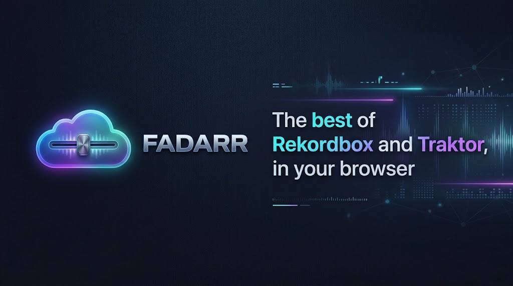
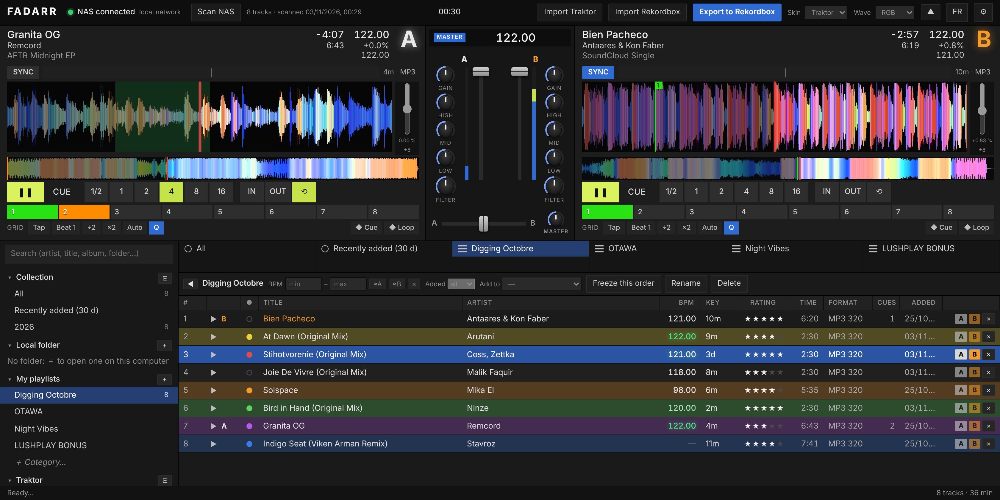

# fadarr

🇬🇧 [English](README.md) · 🇫🇷 **Français**

**Le meilleur de Rekordbox et de Traktor, dans le navigateur — préparer ses sets directement depuis le NAS.**
Importer sa **bibliothèque Traktor _ou_ Rekordbox** (playlists, cues, loops, grilles, tonalités), écouter ses morceaux sur deux decks,
construire des playlists, poser hot cues, memory cues et loops, puis exporter vers Rekordbox pour une clé USB que les CDJ du club lisent proprement.



fadarr est une petite appli web auto-hébergée (Node.js, sans framework ni compilation). Elle tourne dans Docker à côté de ta musique
(Unraid, Synology, n'importe quel serveur Linux) et s'utilise depuis n'importe quel navigateur, chez toi ou via Tailscale.

## Fonctions

- **Deux decks façon Traktor** : en-tête sur trois lignes (titre / artiste / album), temps restant et durée, BPM, % de tempo et BPM d'origine ;
  formes d'onde RGB en couleurs (vue d'ensemble et zoom avec grille, tête de lecture rouge), fader de tempo à côté de l'onde, SYNC et indicateur de phase,
  loops de 1/2 à 16 temps, IN/OUT, 8 hot cues numérotés (hot loops aussi), memory cues et loops, quantize.
- **Interface familière** : thème sombre inspiré de Traktor (aucun logo ni élément graphique de Native Instruments) : arbre avec recherche en haut,
  grille de **favoris** 2 × 6, lignes colorées par morceau, sélection bleue, barre d'état. Replie les decks ou le panneau quand il te faut de la place.
- **Mixeur** : tempo maître, gain, EQ 3 bandes, filtre, faders de voie, crossfader, master ; trois skins (*Traktor*, *Analog*, *Rotary*).
- **Dossier local** : ouvre un dossier de l'ordinateur sur lequel tu es (en plus du NAS) : les morceaux sont lus dans le navigateur, rien n'est envoyé ;
  WAV, AIFF, MP3, FLAC, M4A. BPM, grille, cues, note et couleur de ces morceaux sont gardés dans ce navigateur.
- **Bibliothèque** : analyse du dossier musique (seuls les fichiers nouveaux ou modifiés sont relus), arborescence repliable,
  tri par colonne, filtres BPM et date d'ajout, tonalité musicale / Camelot / Open Key (en couleur), notes en étoiles au clic,
  clic droit pour les couleurs Traktor, figer un tri comme ordre de playlist.
- **Pensé pour préparer un set** : dès qu'un morceau est chargé, la liste met en lumière ce qui s'enchaîne avec lui
  (tonalité compatible sur la roue Camelot, BPM à ±3 % ou demi / double tempo) ; pré-écoute en un clic sans charger de deck.
- **Import Traktor ou Rekordbox** : lit un `collection.nml` Traktor ou un `rekordbox.xml` Rekordbox — playlists et dossiers,
  hot cues, memory cues, loops, BPM, grille, tonalité. Chaque morceau est retrouvé par son nom de fichier (accents et ponctuation
  tolérés), puis par artiste + titre ; les introuvables sont listés. Un nouvel import n'écrase jamais les cues modifiés dans fadarr.
- **Fluide avec les grosses bibliothèques** : la liste est virtualisée (seules les lignes visibles sont dessinées), des milliers de morceaux défilent sans ralentir.
- **Export Rekordbox** : `rekordbox.xml` avec playlists, cues (et leurs couleurs), loops, BPM et grille ; Rekordbox fait ensuite la clé.
- **Importer une clé USB pour CDJ** : fadarr lit une clé préparée par Rekordbox (ou par lui-même) depuis le navigateur :
  playlists et dossiers, hot cues, memory cues et loops (couleurs, noms), grille, tonalité, couleur et note. Les MP3 sont recalés
  fichier par fichier selon leur encodeur (LAME 50 ms, ffmpeg 25 ms, mesuré sur une vraie clé), à l'import comme à l'export.
- **Analyse audio, avec les algorithmes de Mixxx** : « Analyser » dans la barre de la liste calcule BPM et grille (tempo
  constant, arrondi comme Mixxx), tonalité, volume (LUFS, EBU R128) et le début de la musique, sur le serveur ; un morceau
  chargé dans un deck est analysé tout de suite. Ne remplit que ce qui manque : une grille importée de Traktor / Rekordbox
  ou posée à la main n'est jamais remplacée. **Volume harmonisé** (Réglages) : tous les morceaux analysés au même niveau
  dans les decks et la pré-écoute.
- **Clé USB pour CDJ, sans Rekordbox (expérimental)** : fadarr écrit lui-même la clé : musique, base des platines (`export.pdb`) et analyses
  (grille, hot cues et memory cues avec couleurs, formes d'onde en couleurs) pour CDJ-2000NXS2, CDJ-3000 et XDJ.
  Synchro intelligente : seul ce qui a changé depuis le dernier export est réécrit. Nécessite Chrome/Edge en https (ex. `tailscale serve`) ou en localhost.
  Porté de [rbxport](https://github.com/chrisle/rbxport) ; teste la clé sur une vraie platine avant un set.
- **Sans risque** : le dossier musique est monté en lecture seule, fadarr ne modifie jamais un fichier audio. Tout ce qu'il sait est dans `data/fadarr.json`.
- **Bouton NAS** : déconnecter le NAS depuis l'en-tête (bibliothèque et playlists restent consultables, les decks chargés continuent de jouer).
- **Français / anglais**, et prêt pour d'autres langues.

## Ta bibliothèque Traktor, partout

Tu viens de Traktor ? Importe ton `collection.nml` et fadarr lit toute ta bibliothèque : chaque playlist et dossier,
hot cues, memory cues, loops, BPM, grille, tonalité, note et commentaire. Ton travail dans Traktor est alors accessible depuis
n'importe quel navigateur, ordinateur ou tablette, et peut partir vers Rekordbox avec ses cues. Traktor n'a pas besoin d'être
installé sur le serveur, et tes fichiers Traktor ne sont jamais modifiés.

## Installation (Docker Compose)

```bash
git clone https://github.com/mauvestudio/fadarr.git && cd fadarr
cp .env.example .env        # FADARR_MUSIC = ton dossier musique
docker compose up -d --build
```

Ouvre `http://<serveur>:3010`, clique sur **Analyser le NAS**, puis **Importer Traktor** et choisis ton `collection.nml`
(sur Mac : `~/Documents/Native Instruments/Traktor x.y/collection.nml`).

**Unraid** (plugin Compose Manager) : copie `deploy.env.example` en `deploy.env`, remplis-le, puis depuis ton ordinateur lance
`bash installer-unraid.sh` : il envoie le code, crée la stack *fadarr* et la construit. Même commande pour les mises à jour.

Mot de passe facultatif : `AUTH_USER` et `AUTH_PASSWORD` (conseillé si fadarr est joignable hors de chez toi).

## Exporter vers Rekordbox

1. Dans fadarr, roue ⚙ : indique le **chemin du dossier musique vu par ton Mac** (ex. `/Volumes/music/Electronic`).
2. **Exporter vers Rekordbox**, coche les playlists, télécharge `rekordbox.xml` (garde-le toujours au même endroit et remplace-le à chaque export).
3. Rekordbox › Préférences › Avancé › Base de données › *rekordbox xml* : choisis le fichier. Dans l'arborescence, *rekordbox xml* › clic droit sur une playlist › *Importer la playlist*.

Sur certains MP3, Traktor et Rekordbox ne placent pas les cues exactement au même endroit : Réglages › *Décalage des cues pour les MP3* permet de calibrer (WAV et AIFF ne sont pas concernés).

### Clé USB pour les platines CDJ

Le but : une clé que les CDJ lisent avec la grille, les memory cues et les hot cues intacts. fadarr écrit une grille de tempo pour chaque morceau qui a un BPM, pour que les platines affichent la grille et jouent le quantize / SYNC. Après l'export, fadarr indique combien de morceaux ont un BPM, une grille et des cues, et signale ceux qui n'en ont pas. Ensuite : importe la playlist dans Rekordbox, vérifie que grille et cues apparaissent sur le morceau, branche la clé, *Exporter vers le périphérique*, et relis-la sur une CDJ (ou le mode Export de Rekordbox) avant la soirée. Un morceau sans BPM n'aura pas de grille sur les platines : charge-le dans fadarr et clique sur son BPM pour le poser.

## Clavier

`Q` / `W` lecture deck A / B · `A` / `S` cue deck A / B · potards : glisser, molette, flèches, double-clic pour remettre à zéro (Maj pour le réglage fin).

## Traductions

Tous les textes de l'interface passent par `public/i18n.js` (et `src/i18n.js` pour les messages du serveur). Le français est la langue source.
Pour ajouter une langue : copier le bloc `en`, traduire les valeurs et ajouter la langue à `LANGS`.

## Licence

GPL-2.0-ou-ultérieure — voir [LICENSE](LICENSE) et [NOTICE.md](NOTICE.md) (l'export USB est un portage d'une partie de [rbxport](https://github.com/chrisle/rbxport) ; fadarr était sous MIT jusqu'à la 0.9.1). Sans lien avec Native Instruments ni AlphaTheta/Pioneer DJ ; Traktor et Rekordbox sont des marques de leurs propriétaires.
