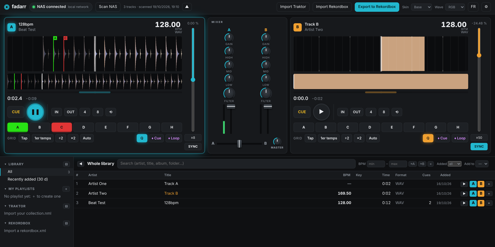

# mixarr

🇬🇧 [English](README.md) · 🇫🇷 **Français**

**Le meilleur de Rekordbox et de Traktor, dans le navigateur — préparer ses sets directement depuis le NAS.**
Importer sa **bibliothèque Traktor _ou_ Rekordbox** (playlists, cues, loops, grilles, tonalités), écouter ses morceaux sur deux decks,
construire des playlists, poser hot cues, memory cues et loops, puis exporter vers Rekordbox pour une clé USB que les CDJ du club lisent proprement.



mixarr est une petite appli web auto-hébergée (Node.js, sans framework ni compilation). Elle tourne dans Docker à côté de ta musique
(Unraid, Synology, n'importe quel serveur Linux) et s'utilise depuis n'importe quel navigateur, chez toi ou via Tailscale.

## Fonctions

- **Deux decks** : formes d'onde colorées par fréquences (vue d'ensemble et zoom avec grille de tempo), lecture / CUE, tempo ±8 / ±16 / ±50 %,
  un gros BPM sur lequel on clique pour le régler, un bouton **SYNC** qui s'allume quand les tempos sont calés,
  indicateur de phase, 8 hot cues (et hot loops), loops (IN/OUT, 4 ou 8 temps), memory cues et memory loops, quantize.
- **Disposition inspirée de Traktor**, à ta main : replie les decks ou le panneau de gauche pour te concentrer sur la recherche ou sur le mix.
- **Mixeur** : gain, EQ 3 bandes, filtre, faders de voie, crossfader, master ; trois skins (*Base*, *Analog*, *Rotary*).
- **Bibliothèque** : analyse du dossier musique (seuls les fichiers nouveaux ou modifiés sont relus), arborescence repliable,
  tri sur toutes les colonnes, filtre de BPM, tonalité en notation musicale / Camelot / Open Key.
- **Pensé pour préparer un set** : dès qu'un morceau est chargé, la liste met en lumière ce qui s'enchaîne avec lui
  (tonalité compatible sur la roue Camelot, BPM à ±3 % ou demi / double tempo) ; pré-écoute en un clic sans charger de deck.
- **Import Traktor ou Rekordbox** : lit un `collection.nml` Traktor ou un `rekordbox.xml` Rekordbox — playlists et dossiers,
  hot cues, memory cues, loops, BPM, grille, tonalité. Chaque morceau est retrouvé par son nom de fichier (accents et ponctuation
  tolérés), puis par artiste + titre ; les introuvables sont listés. Un nouvel import n'écrase jamais les cues modifiés dans mixarr.
- **Fluide avec les grosses bibliothèques** : la liste est virtualisée (seules les lignes visibles sont dessinées), des milliers de morceaux défilent sans ralentir.
- **Export Rekordbox** : `rekordbox.xml` avec playlists, cues (et leurs couleurs), loops, BPM et grille ; Rekordbox fait ensuite la clé.
- **Sans risque** : le dossier musique est monté en lecture seule, mixarr ne modifie jamais un fichier audio. Tout ce qu'il sait est dans `data/mixarr.json`.
- **Bouton NAS** : déconnecter le NAS depuis l'en-tête (bibliothèque et playlists restent consultables, les decks chargés continuent de jouer).
- **Français / anglais**, et prêt pour d'autres langues.

## Ta bibliothèque Traktor, partout

Tu viens de Traktor ? Importe ton `collection.nml` et mixarr lit toute ta bibliothèque : chaque playlist et dossier,
hot cues, memory cues, loops, BPM, grille, tonalité, note et commentaire. Ton travail dans Traktor est alors accessible depuis
n'importe quel navigateur, ordinateur ou tablette, et peut partir vers Rekordbox avec ses cues. Traktor n'a pas besoin d'être
installé sur le serveur, et tes fichiers Traktor ne sont jamais modifiés.

## Installation (Docker Compose)

```bash
git clone https://github.com/mauvestudio/mixarr.git && cd mixarr
cp .env.example .env        # MIXARR_MUSIC = ton dossier musique
docker compose up -d --build
```

Ouvre `http://<serveur>:3010`, clique sur **Analyser le NAS**, puis **Importer Traktor** et choisis ton `collection.nml`
(sur Mac : `~/Documents/Native Instruments/Traktor x.y/collection.nml`).

**Unraid** (plugin Compose Manager) : copie `deploy.env.example` en `deploy.env`, remplis-le, puis depuis ton ordinateur lance
`bash installer-unraid.sh` : il envoie le code, crée la stack *mixarr* et la construit. Même commande pour les mises à jour.

Mot de passe facultatif : `AUTH_USER` et `AUTH_PASSWORD` (conseillé si mixarr est joignable hors de chez toi).

## Exporter vers Rekordbox

1. Dans mixarr, roue ⚙ : indique le **chemin du dossier musique vu par ton Mac** (ex. `/Volumes/music/Electronic`).
2. **Exporter vers Rekordbox**, coche les playlists, télécharge `rekordbox.xml` (garde-le toujours au même endroit et remplace-le à chaque export).
3. Rekordbox › Préférences › Avancé › Base de données › *rekordbox xml* : choisis le fichier. Dans l'arborescence, *rekordbox xml* › clic droit sur une playlist › *Importer la playlist*.

Sur certains MP3, Traktor et Rekordbox ne placent pas les cues exactement au même endroit : Réglages › *Décalage des cues pour les MP3* permet de calibrer (WAV et AIFF ne sont pas concernés).

### Clé USB pour les platines CDJ

Le but : une clé que les CDJ lisent avec la grille, les memory cues et les hot cues intacts. mixarr écrit une grille de tempo pour chaque morceau qui a un BPM, pour que les platines affichent la grille et jouent le quantize / SYNC. Après l'export, mixarr indique combien de morceaux ont un BPM, une grille et des cues, et signale ceux qui n'en ont pas. Ensuite : importe la playlist dans Rekordbox, vérifie que grille et cues apparaissent sur le morceau, branche la clé, *Exporter vers le périphérique*, et relis-la sur une CDJ (ou le mode Export de Rekordbox) avant la soirée. Un morceau sans BPM n'aura pas de grille sur les platines : charge-le dans mixarr et clique sur son BPM pour le poser.

## Clavier

`Q` / `W` lecture deck A / B · `A` / `S` cue deck A / B · potards : glisser, molette, flèches, double-clic pour remettre à zéro (Maj pour le réglage fin).

## Traductions

Tous les textes de l'interface passent par `public/i18n.js` (et `src/i18n.js` pour les messages du serveur). Le français est la langue source.
Pour ajouter une langue : copier le bloc `en`, traduire les valeurs et ajouter la langue à `LANGS`.

## Licence

MIT — voir [LICENSE](LICENSE). Sans lien avec Native Instruments ni AlphaTheta/Pioneer DJ ; Traktor et Rekordbox sont des marques de leurs propriétaires.
