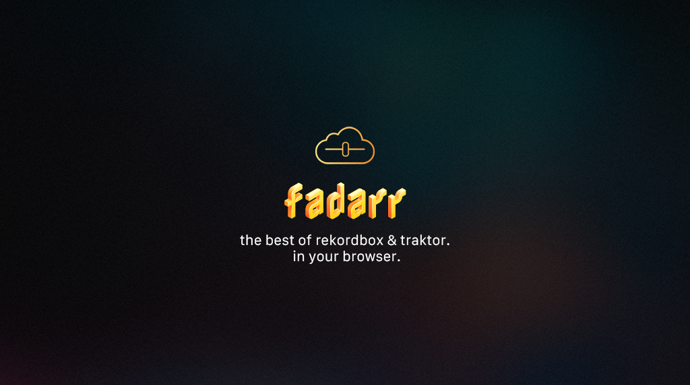
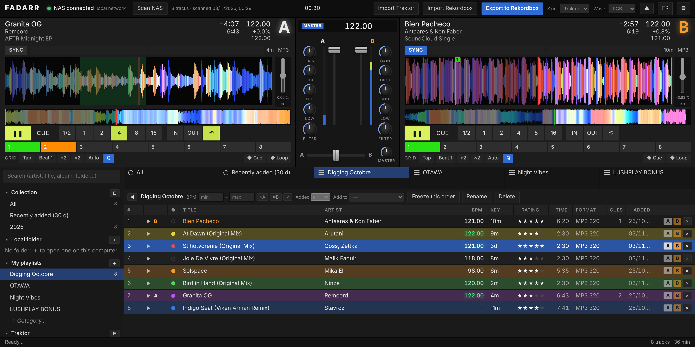

# fadarr

🇬🇧 **English** · 🇫🇷 [Français](LISEZMOI.md)

**The best of Rekordbox and Traktor, in your browser — prep your DJ sets straight from your NAS.**
Import your **Traktor _or_ Rekordbox library** (playlists, cues, loops, beat grids, keys), audition tracks on two decks, build playlists,
set hot cues, memory cues and loops — then export back to Rekordbox for a USB stick your club's CDJ players read cleanly.



fadarr is a small self-hosted web app (Node.js, no framework, no build step). It runs in Docker next to your music
(Unraid, Synology, any Linux box) and you use it from any browser on your network or over Tailscale.

## Features

- **Two decks, Traktor-style** — three-line header (title / artist / album), remaining and total time, BPM, tempo % and original BPM;
  full-colour RGB waveforms (overview + zoom with beat grid, red playhead), tempo fader next to the waveform, SYNC and beat-phase meter,
  loop sizes 1/2 to 16 beats, IN/OUT, 8 numbered hot cues (hot loops too), memory cues and loops, quantize.
- **Familiar layout** — dark Traktor-like interface (no Native Instruments logos or artwork): collection tree with search on top,
  a 2×6 **favourites** grid, full-row track colours, blue selection, status bar. Collapse the decks or the side panel when you need room.
- **Mixer** — master tempo, gain, 3-band EQ, filter, channel faders, crossfader, master; three skins (*Traktor*, *Analog*, *Rotary*).
- **Sticks & drives, played directly** — mount one or more USB sticks or drives (Rekordbox-style devices panel). A CDJ stick shows its playlists and plays its tracks with their cues, loops and grid, straight from the stick (nothing is written to it). Any other folder (SSD, hard drive) works too: tracks are read in the browser, nothing is uploaded;
  WAV, AIFF, MP3, FLAC, M4A. BPM, grid, cues, rating and colour for those tracks are kept in that browser.
- **Library** — scans your music folder (only new or changed files are re-read), collapsible folder tree,
  sort by any column, BPM range and date-added filters, key shown as musical / Camelot / Open Key (colour-coded), click-to-rate stars,
  right-click for Traktor colours, freeze a sorted order into a playlist.
- **Built for set preparation** — once a track is loaded, the list highlights what mixes with it
  (Camelot-compatible key, BPM within 3 % or half/double tempo); one-click preview without loading a deck.
- **Import from Traktor or Rekordbox** — read a Traktor `collection.nml` or a Rekordbox `rekordbox.xml`: playlists and folders,
  hot cues, memory cues, loops, BPM, beat grid, key. Tracks are matched to your files by name (accents and punctuation tolerated),
  then by artist + title; unmatched tracks are listed. Re-importing never overwrites cues you edited in fadarr.
- **Fast with big libraries** — the track list is virtualised (only visible rows are drawn), so thousands of tracks scroll smoothly.
- **Rekordbox export** — `rekordbox.xml` with playlists, cues (with colours), loops, BPM and grid; Rekordbox then builds the USB stick.
- **USB stick for CDJs, without Rekordbox (experimental)** — fadarr writes the stick itself: audio, the players' database (`export.pdb`) and
  analysis files (beat grid, hot cues and memory cues with colours, colour waveforms) for CDJ-2000NXS2, CDJ-3000 and XDJ players.
  Smart sync: only what changed since the last export is rewritten. Needs Chrome/Edge over https (e.g. `tailscale serve`) or localhost.
  Ported from [rbxport](https://github.com/chrisle/rbxport); test the stick on a real player before a gig.
- **Import a CDJ USB stick** — read a stick made by Rekordbox (or fadarr) straight from the browser: playlists and folders,
  hot cues, memory cues and loops (colours, names), beat grid, key, track colour and rating. MP3 timings are corrected per file
  for their encoder (LAME 50 ms, ffmpeg 25 ms — measured on a real stick), on import and on export.
- **Audio analysis, with Mixxx's algorithms** — *Analyse* in the list toolbar detects BPM and beat grid (constant tempo,
  rounded like Mixxx, plus a kick-drum phase check: 87 % of grids match Rekordbox's on a test stick, up from 67 %), key, loudness (LUFS, EBU R128) and where the music starts, on the server; a track loaded on a deck
  is analysed on the spot. It only fills what is missing: a grid imported from Traktor / Rekordbox or set by hand is never replaced.
  **Loudness matching** (Settings) brings every analysed track to the same level on the decks and in the preview.
- **Safe by design** — the music folder is mounted read-only: fadarr never modifies an audio file. Everything it knows lives in `data/fadarr.json`.
- **NAS switch** — disconnect the NAS from the header (library and playlists stay browsable; loaded decks keep playing).
- **French / English** — and ready for more languages (see below).

## Your Traktor library, anywhere

Coming from Traktor? Import your `collection.nml` and fadarr reads your whole library: every playlist and folder,
hot cues, memory cues, loops, BPM, beat grid, key, rating and comment. Your Traktor work is then available from any browser,
on any computer or tablet — and can go on to Rekordbox with its cues intact. Traktor itself is not needed on the server
and your Traktor files are never modified.

## Install (Docker Compose)

```bash
git clone https://github.com/mauvestudio/fadarr.git && cd fadarr
cp .env.example .env        # set FADARR_MUSIC to your music folder
docker compose up -d --build
```

Open `http://<server>:3010`, click **Scan NAS**, then **Import Traktor** and pick your `collection.nml`
(macOS: `~/Documents/Native Instruments/Traktor x.y/collection.nml`).

**Unraid** (Compose Manager plugin): copy `deploy.env.example` to `deploy.env`, fill it in, then from your computer run
`bash installer-unraid.sh` — it uploads the code, creates the *fadarr* stack and builds it. Same command to update.

Optional password: set `AUTH_USER` and `AUTH_PASSWORD` (recommended if fadarr is reachable from outside your home).

## Export to Rekordbox

1. In fadarr, ⚙ Settings: set the **music folder path as seen by your Mac** (e.g. `/Volumes/music/Electronic`).
2. **Export to Rekordbox**, tick the playlists, download `rekordbox.xml` (keep it at a fixed place and overwrite it each time).
3. Rekordbox › Preferences › Advanced › Database › *rekordbox xml*: select the file. In the tree, *rekordbox xml* › right-click a playlist › *Import Playlist*.

Cue timing between Traktor and Rekordbox can differ slightly on some MP3s: Settings › *MP3 cue offset* lets you calibrate it (WAV/AIFF are not affected).

### USB for CDJ players

The goal is a USB stick that CDJs read with their grid, memory cues and hot cues intact. fadarr writes a beat grid for every track that has a BPM, so the players can show the grid and run quantize/SYNC. After export, fadarr reports how many tracks have a BPM, a grid and cues, and flags any that don't. Then: import the playlist in Rekordbox, check the grid and cues appear on the track, plug in the stick, *Export to device*, and read it on a CDJ (or Rekordbox's Export mode) before the gig. A track with no BPM gets no grid on the players — load it in fadarr and click its BPM to set one.

## Keyboard

`Q` / `W` play deck A / B · `A` / `S` cue deck A / B · knobs: drag, mouse wheel, arrow keys, double-click to reset (Shift for fine control).

## Translations

All interface text goes through `public/i18n.js` (and `src/i18n.js` for server messages). French is the source language.
To add a language: copy the `en` block, translate the values and add the language to `LANGS`. Pull requests welcome.

## Development

```bash
npm install
MUSIC_DIR=/path/to/music DATA_DIR=./data npm start   # http://localhost:3010
```

`analyzer/` C++ analyser (qm-dsp, Mixxx's algorithms): `npm run build:analyzer` (needs a C++ compiler; the Docker image builds it).
`src/` server (Express): `analysis.js` (analysis queue), `library.js` (scan), `traktor.js` (NML import), `rekordbox.js` (XML export), `store.js` (database).
`public/` client: `app.js` (decks, Web Audio, waveforms, library), `app.css`, `i18n.js`. AIFF is converted to WAV on the fly with ffmpeg for browsers that cannot decode it.

## Roadmap

Beat-grid editing · MIDI controllers · waveform cache / mini-waveforms in the list · two-way Traktor sync.

## License

GPL-2.0-or-later — see [LICENSE](LICENSE) and [NOTICE.md](NOTICE.md) (the USB export is a port of parts of [rbxport](https://github.com/chrisle/rbxport); fadarr was MIT up to 0.9.1). Not affiliated with Native Instruments or AlphaTheta/Pioneer DJ; Traktor and Rekordbox are trademarks of their owners.
